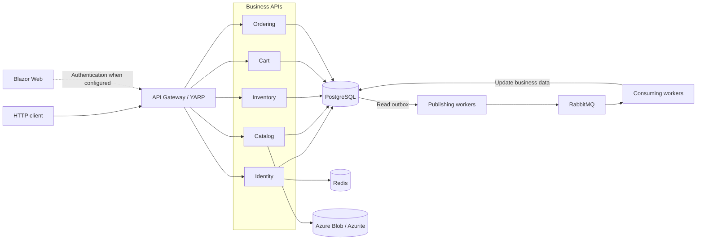

# Vendora

Vendora is an e-commerce project for developers building commerce services and a storefront. It uses **.NET 10**, separates business capabilities into five microservices, exposes APIs through a Gateway, and provides a **Blazor Interactive Server** frontend.

> **Under development:** The Web frontend uses sample data. Authentication, cart, and ordering workflows are not yet fully integrated between Web and the backend.

## Start with the demo storefront

Install the **.NET SDK 10**, then run these commands from the repository root:

```sh
dotnet restore src/Web/Vendora.Web.csproj
dotnet run --project src/Web/Vendora.Web.csproj --launch-profile http
```

Open [http://localhost:5111](http://localhost:5111). The homepage displays sample products labeled “Demo catalog.” Search for `headphones`, then open `/products/headphones` to explore variants and the image gallery. This demo does not require the backend. Adding an item to the cart only displays demo feedback.

To run the backend, follow the [Docker Compose guide](composes/README.md): prepare environment files, secrets, and RSA keys, validate the configuration, start the stack, and open Scalar. Web runs separately from Compose.

## Components and current capabilities

| Component | Scope in the codebase |
| --- | --- |
| Identity | Registration, login, logout, email verification, and employee account creation |
| Catalog | Products, variants, categories, product lifecycle states, and product/variant images stored in Azure Blob Storage (Azurite locally) |
| Inventory | Stock queries, adjustments, availability checks, and reservations (reservations require an authenticated user) |
| Cart | Adding, removing, updating quantities, and querying cart items |
| Ordering | Placing, canceling, preparing, delivering, and completing orders |
| API Gateway | HTTP routing through YARP and aggregated API documentation in Development |
| Web | Searching/filtering sample data, product details, variant selection, image galleries, and authentication forms |

The backend uses ASP.NET Core Minimal APIs, Entity Framework Core 10, and PostgreSQL 18. Redis supports Identity; RabbitMQ carries events between services; Catalog stores product images in Azure Blob Storage, emulated locally by Azurite. `InventoryItem` and `Order` use PostgreSQL `xmin` as an optimistic concurrency token. API authentication uses JSON Web Tokens (JWTs) signed with RSA keys. Web uses MudBlazor and locally hosted Inter fonts, supports light/dark/system themes, and displays its interface in English.

## Architecture

Each service contains `Api`, `Application`, `Domain`, `Infrastructure`, and `Worker` projects. Api handles HTTP, Application coordinates use cases, Domain holds business rules, and Infrastructure handles persistence and external integrations. Workers publish outbox events or process events received from RabbitMQ.

Each use case lives in one file in `Application` as a static class with nested `Command` or `Query`, `Handler`, `Response`, and related types; the matching Api folder holds the endpoint and its request class (for example `GetProductEndpoint` and `GetProductRequest`).

An outbox stores events in the same transaction as business data before a worker publishes them asynchronously. Services also call each other directly over HTTP; for example, Ordering has clients for Cart, Catalog, and Inventory.



This diagram summarizes groups of connections. The Web catalog and cart do not currently call the Gateway.

```text
Vendora.slnx             # .NET solution
compose.yaml            # Combined backend configuration
composes/               # Infrastructure, APIs, workers, local env files and secrets
src/
  ApiGateway/           # YARP and API documentation
  BuildingBlocks/       # Shared CQRS, messaging, and result types
  Services/             # Identity, Catalog, Inventory, Cart, Ordering
  Web/                  # Blazor, features, UI components, and static assets
```

`BuildingBlocks/Cqrs` provides Command Query Responsibility Segregation (CQRS) infrastructure, separating requests that change data from queries. The `tests/` and `docs/` directories are currently empty.

## Project status

Last updated 2026-11-24, against `main` at commit `0a81a98`.

**Recently completed**

- Catalog: create products with multiple images (multipart upload to Azure Blob Storage) and assign images to variants; `GET /products/{id}` returns image URLs and each variant's `ImageIds`; `GET /products` returns each product's primary image URL.
- API Gateway: `/media/{**key}` serves product images from Azurite (Development configuration). Catalog creates the `catalog-images` container at startup with public read access for blobs.
- Inventory: initializing an inventory item is idempotent for a repeated `catalog.product-variant.added` event; `product_variant_id` and `sku` are unique; `InventoryItem` has a concurrency token; reservations require authentication and Ordering forwards the user's token.
- Ordering: events use `VariantId`; cancelling an already cancelled order is rejected, so stock is not released twice; `Order` has a concurrency token; marking a cancelled or rejected order as paid is rejected.
- Use case structure: every use case in Identity, Catalog, Inventory, Cart, and Ordering is a static class in `Application` (for example `GetProduct`, `PlaceOrder`, `ReserveInventoryItems`) with nested `Command` or `Query`, `Response`, DTOs, `IQueryService`, `Errors`, and `Handler`. Commands, queries, responses, and DTOs are records with constructor parameters, except `CreateProduct.ProductVariantDto`, which ASP.NET binds from the multipart form. Api request classes build these records, and each Api `Program.cs` sets `CreateSchemaReferenceId` so OpenAPI schema ids are `<UseCase><Type>` (for example `ListOrdersResponse`) instead of colliding on `Response`.
- Catalog: creating a product now requires at least one image (`product_creation.images_empty`).
- Error handling: all five APIs (Identity, Catalog, Inventory, Cart, and Ordering) map concurrency conflicts and unique-constraint violations to HTTP 409 and log other unhandled exceptions as HTTP 500 with a generic error body. Inventory reserve and stock release retry up to 3 times on a concurrency conflict.

**Known gaps (not yet fixed)**

| Area | Gap |
| --- | --- |
| Error handling | The 500 handler writes the `Error` object directly while the 409 handler writes `error.ToResponse()`; the two bodies may have different JSON shapes |
| Inventory reservation | Any authenticated user can call `/api/inventory-items/reserve` through the Gateway; there is no service-to-service policy |
| Placing orders | Stock is reserved over HTTP inside the Ordering database transaction, with no compensation or idempotency key |
| Messaging | Catalog/Identity outbox workers stop on the first publish error; the RabbitMQ consumer requeues failures forever (no dead-letter queue) and does not reconnect |
| Creating products | Image indexes, file type, and file size are not validated; images upload before the command is validated (a SKU that already exists on another product now returns 409, but only after the upload); failed commits can leave orphaned blobs |
| Product details | Availability is requested with the product id instead of each variant id, and the result is not returned |
| Product list | `GET /products` reads the primary image with `Single(IsPrimary)`; products without images (for example, created before the image feature) may fail the whole list or produce an invalid URL |
| Media route | The Gateway `/media` route hard-codes the dev account name `catalogdevaccount` and exists only in `appsettings.Development.json` |

## Development and verification

Building on the host requires the .NET SDK 10. Run from the repository root:

```sh
dotnet restore Vendora.slnx
dotnet build Vendora.slnx --no-restore
```

The repository has no automated test projects yet. A build verifies compilation; API and cross-service workflows still need testing with workers running. Component READMEs describe suggested manual checks.

Documented commands have been checked against source code and configuration. `docker compose config --quiet` passed with the existing local configuration files. Restore, builds, applications, containers, and browser checks were not run during this documentation update because the session permits writes only to README files.

## Component documentation

| Guide | Contents |
| --- | --- |
| [Backend and Docker Compose](composes/README.md) | Prerequisites, environment files/secrets, migrations, API addresses, and troubleshooting |
| [Web](src/Web/README.md) | Running Blazor, routes, frontend structure, and integration limits |
| [Home](src/Web/Features/Home/README.md) | Sample catalog, search, categories, and navigation |
| [Products](src/Web/Features/Products/README.md) | Details, variants, images, and quantity selection |
| [Authentication](src/Web/Features/Authentication/README.md) | Forms, Gateway configuration, and API contracts |
| [Shared UI](src/Web/Components/UI/README.md) | Components, usage examples, themes, and integration conventions |

## License

The repository does not contain a project-wide license file. The Inter font license is provided separately in [LICENSE.txt](src/Web/wwwroot/fonts/inter/LICENSE.txt) and applies to the font.
